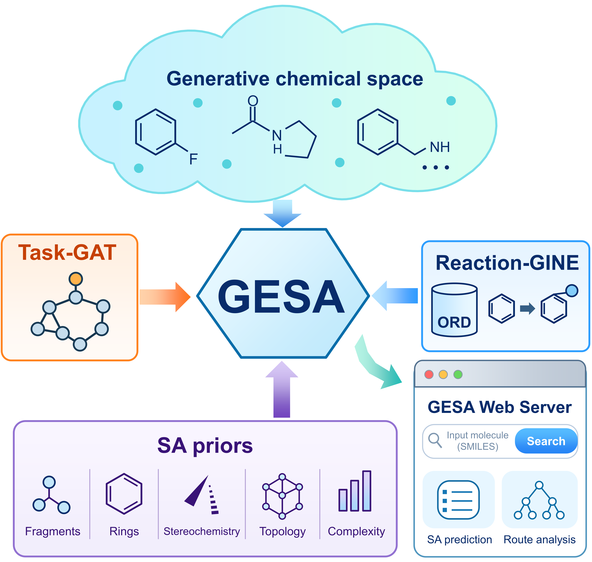

# GESA

[Web server](https://lmmd.ecust.edu.cn/GESA) · [Dataset](https://doi.org/10.5281/zenodo.22874755)

Official code and data repository for:

**GESA: Expanding Synthetic Accessibility Prediction into Generative Chemical Space**

Xinmin Li, Le Xiong, Wenxiang Song, Hongbo Yu, Meiling Zhan, Guixia Liu, Weihua Li, Yun Tang*

**Affiliations**

1. Shanghai Frontiers Science Center of Optogenetic Techniques for Cell Metabolism
2. Shanghai Key Laboratory of New Drug Design, School of Pharmacy, East China University of Science and Technology, Shanghai 200237, China

**Corresponding author:** Yun Tang — [ytang234@ecust.edu.cn](mailto:ytang234@ecust.edu.cn)

**Manuscript status:** Under submission.

GESA is a molecular synthetic-accessibility prediction framework combining
supervision expanded into generative chemical space with task-specific,
reaction-informed, and explicit synthetic-accessibility evidence.



## Web server

Access the GESA web server at **[https://lmmd.ecust.edu.cn/GESA](https://lmmd.ecust.edu.cn/GESA)**.

## Architecture

```text
Molecule
   |
   +-- Task-GAT -------- task-specific SA representation --+
   |                                                       |
   +-- Reaction-GINE --- reaction-informed representation -+
                                                           v
                                                Atom-wise Source Gating
                                                           |
                                                Attentive Molecular Readout
                                                           |
                                                + Explicit SA Priors
                                                           |
                                                           v
                                                          GESA
```

Both graph encoders use atom, bond, and connectivity information. Task-GAT uses
edge-aware graph attention; Reaction-GINE uses bond-conditioned message passing.
The aligned atom representations are fused before attentive molecular pooling and
concatenation with fourteen explicit SA priors.

## Quick start

Create the environment and expose the source package:

```bash
conda env create -f environment.yml
conda activate gesa
export PYTHONPATH="$PWD/src:${PYTHONPATH}"
```

Python API:

```python
from gesa import load_gesa, predict_smiles

model, metadata = load_gesa("weights/GESA.pt")
scores, errors = predict_smiles(model, ["CCO", "c1ccccc1"])
```

Command line:

```bash
python scripts/predict.py \
    --checkpoint weights/GESA.pt \
    --input molecules.csv \
    --output predictions.csv
```

## Label and score semantics

GESA uses `0 = ES` (easy to synthesize) and `1 = HS` (hard to synthesize).
HS is the positive class throughout training and evaluation. `GESA_score` is
`P(HS)` rather than an easy-to-synthesize probability, so larger values indicate
greater predicted synthetic difficulty. At the natural probability boundary,
`GESA_score >= 0.5` is classified as HS and `GESA_score < 0.5` as ES.

Accordingly, AUROC and PRAUC use HS as the positive label; Recall, Precision,
and F1 are HS-class metrics; Specificity is the true-negative rate for ES.
In confusion matrices, TP is a correctly predicted HS molecule and TN is a
correctly predicted ES molecule. For GESA, molecules with scores at or above
the threshold are classified as HS.

## External evaluation

Across seeds 42, 123, and 2026, AUROC was:

| Dataset | GESA AUROC, mean ± sample SD |
|---|---:|
| TS1 | 0.983047 ± 0.003802 |
| TS2 | 0.941277 ± 0.001076 |
| TS3 | 0.884411 ± 0.002281 |
| TS4 | 0.900972 ± 0.002585 |
| Equal-weight TS1–TS4 macro-average | 0.927427 ± 0.000451 |

These values are regenerated from the released `y_true` and `y_score` arrays by
`scripts/evaluate_ts1_ts4.py`; they are not manually entered into result CSVs.

## Reproduction

```bash
python scripts/evaluate_ts1_ts4.py
```

Fine-tuning on user-provided training and validation splits:

```bash
python scripts/train_gesa.py --config configs/gesa.yaml
```

Set the training and validation paths in `configs/gesa.yaml` first. By default,
this script initializes from the released `weights/GESA.pt` checkpoint and
fine-tunes it; this command does not reproduce the complete pretraining and
training pipeline from scratch.

## Training data

**Companion dataset:** [Zenodo — 10.5281/zenodo.22874755](https://doi.org/10.5281/zenodo.22874755).

Benchmark and case-study source data are included in this repository. The
companion training-data record is linked above. To use the training data,
extract the dataset locally and set the training and validation paths in
`configs/gesa.yaml` at the repository root.

## Repository map

- `assets/`: graphical overview of GESA

- `src/gesa/`: public model and inference API
- `weights/`: public checkpoint and usage notes
- `benchmarks/external/`: nine-model external evaluation and source predictions
- `benchmarks/internal/`: eight-model framework comparison
- `case_studies/`: compact stepwise-route and SyntheMol manuscript source data
- `baselines/`: standard GNN baseline implementations
- `RELEASE_MANIFEST.csv`: file sizes and SHA256 checksums

Benchmark and case-study tables are retained as source data. Rendered figures
and internal release-building tools are not included.

## License

The original GESA source code is released under the [MIT License](LICENSE).
Third-party datasets and software retain their respective licenses and terms
of use.
